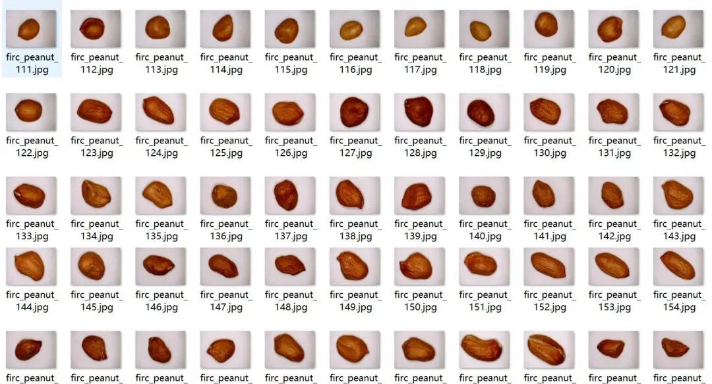
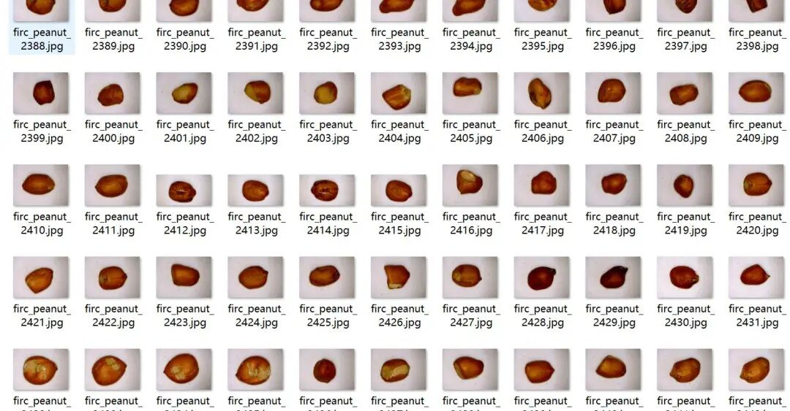
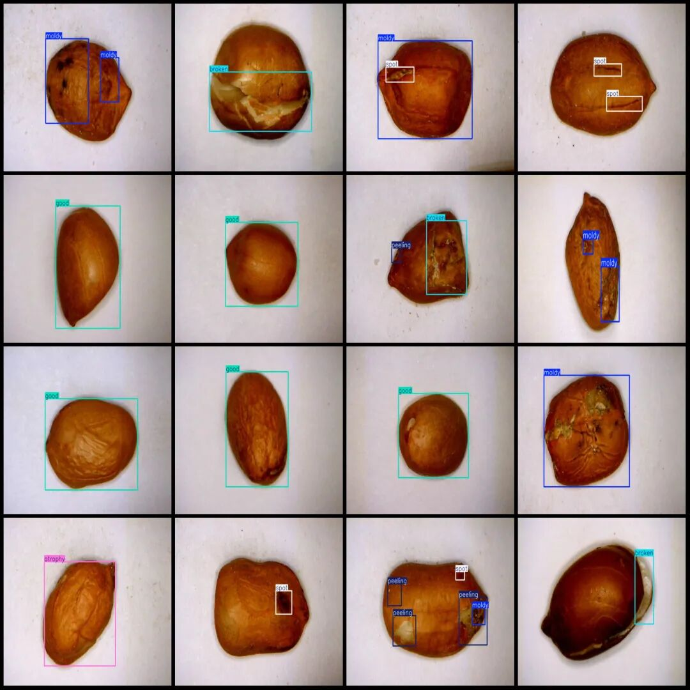

# Peanut Shell Quality Inspection Defect Detection Dataset in VOC+YOLO format with 3340 images across 6 categories

Dataset format: Pascal VOC format + YOLO format (txt file without split path, only containing jpg images and corresponding VOC format xml files and yolo format txt files)

Number of images (number of jpg files): 3340

Number of annotations (number of xml files): 3340

Number of annotations (number of txt files): 3340

Label count: 6

Label category names (note that the order of yolo format categories does not correspond to this, but is based on the labels folder's classes.txt): ["atrophy", "broken", "good", "mold", "peeling", "spot"]

Number of boxes labeled in each category:

Atrophy frame count = 800

Broken frame count = 800

Good frame count = 799

Mouldy frame count = 800

Peeling frame count = 800

Spot frame count = 800

Total frame count: 4799

Using labelImg:

Image resolution: 640x480

Annotation rules: Draw a rectangle around the category.

Important Notice: No

Special : This dataset does not guarantee the accuracy of the trained models or weight files.

Image Preview:

Annotation example:

## Payment

Here is a pay link on Stripe ( https://buy.stripe.com/3cs8yP7sY87d0vu9AB ). Please contact me lonlonago@foxmail.com after funding $89, and I will send you a complete data files , thank you!

